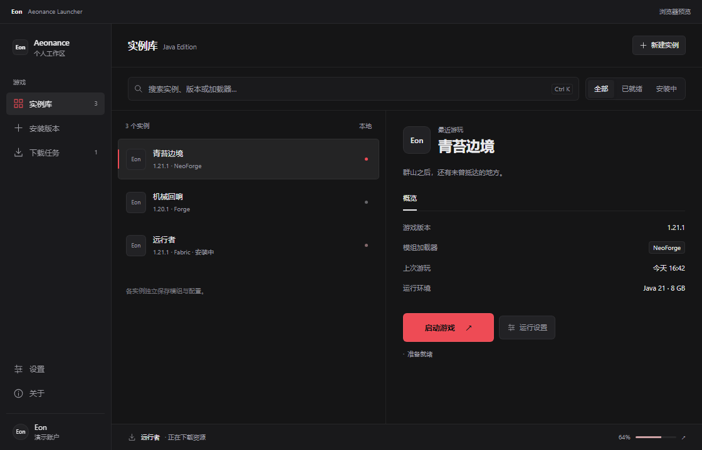

# Aeonance Launcher

An independently developed desktop launcher for Minecraft: Java Edition, with a focus on interface design, smooth interaction, and local instance management.

一款独立开发中的 Minecraft Java 版桌面启动器，注重界面设计、流畅交互与本地实例管理。

**In development · Windows · Private preview · Source code is not published in this repository**
**开发中 · Windows · 内部预览 · 本仓库不公开程序源码**

## 中文介绍

Aeonance Launcher 将游戏安装、多个目录的实例管理、账号切换、运行环境和模组下载集中在一个桌面程序中。界面支持深浅主题、主次色与全局背景调整，并为页面切换、实例选择和弹窗提供过渡动效。

### 当前进度

更新日期：**2026-11-04**
当前内部预览版本：**0.32.1**

原版与已接入加载器的安装、游戏启动和日志流程已实现，微软账号登录及在线身份启动已实际验证。项目目前用于个人及小团体测试，短期内暂无公开发行计划；此仓库不提供程序下载。

| 功能 | 当前状态 |
| --- | --- |
| 实例与目录管理 | 管理多个游戏目录；新建实例默认隔离，支持名称、图标及独立运行设置 |
| 已有游戏接入 | 支持直接接入或复制导入已有游戏，批量识别实例；兼容已识别的独立实例布局 |
| Minecraft 本体 | 版本浏览、分类、搜索、安装，以及下载来源选择、缓存复用、并发和大文件分段下载 |
| 启动前检查与修复 | 快速检查运行文件，缺失或大小异常时自动补全；手动校验／修复保留完整内容校验 |
| 加载器 | 已接入 Fabric、Forge、NeoForge、OptiFine 安装与启动；支持可选 Fabric API 及符合兼容规则的 Forge + OptiFine 混装 |
| 账号与游戏启动 | 全局切换微软在线身份／离线身份，选中实例直接启动；提供游戏进程状态与日志 |
| Java 与运行设置 | 本机 Java 检测、自动匹配和兼容 Java 下载；全局设置与实例独立设置分开，支持内存滑条 |
| 本地模组管理 | 模组信息读取、搜索、添加、批量启用／禁用和删除 |
| Modrinth 模组下载 | 按关键词、游戏版本、加载器和排序浏览；查看文件版本及关联模组，下载时选择位置和文件名 |
| 下载导航与任务中心 | “下载”分为“MC 本体”和“Mod”；“任务中心”单独显示进行中任务和下载历史 |
| 窗口与界面 | 主题设置、过渡动画、系统托盘、关闭按钮行为及游戏启动后的窗口行为 |

已有游戏接入优先复用本地运行文件。启动检查不会自动安装模组前置、解决模组冲突，或恢复用户主动禁用／删除的模组；相关问题通过日志交给用户判断。直接接入的实例仍使用原位置的存档、配置和模组，移除接入记录不会删除原实例。

### 最近更新

- **0.32.1**：修复从“下载”切到“任务中心”时，侧边栏红色选中框因子栏收起而错位的问题，包括快速连续切换。
- **0.32.0**：将 MC 本体与 Mod 浏览统一到“下载”；增加独立的游戏版本／加载器筛选，Mod 下载使用 Windows“另存为”。从实例模组管理跳转时，带入筛选条件，保存窗口默认打开该实例的 mods 文件夹。
- **0.31.0**：接入 Modrinth 搜索、项目与版本浏览、关联模组入口及下载任务。
- **0.30.0**：启动时按快速检查结果补全缺失或异常运行文件，减少重复校验，保留手动完整修复入口。

已对部分历史及较新版本的原版、加载器安装与启动进行实际验证，并检查导入、文件补全、本地模组操作和资源下载。尚未覆盖全部 Minecraft 版本、加载器组合与整合包；内部预览不代表对所有组合的兼容保证。

### 账号认证与隐私

Minecraft Services 应用访问资格已获准，完整微软登录及在线身份启动已通过实际验证。这是 API 访问批准，不代表 Mojang 或 Microsoft 对本项目的背书。

登录在微软网页中完成，启动器不接收微软账号密码。认证流程用于获取 Minecraft 玩家身份并验证游戏所有权。访问令牌保存在内存中；刷新令牌使用 Windows 当前用户范围的 DPAPI 加密后保存在本机。

离线身份用于本地游戏，不提供有效的微软在线认证；要求正版验证的服务器仍需有效的在线身份。

### 后续开发

- 准备申请 CurseForge API Key，并接入模组搜索、版本筛选和下载。目前 **CurseForge 尚未接入**，在线模组资源来源为 Modrinth。
- 继续完善已有实例布局和不同游戏／加载器版本的兼容性与错误日志。
- 在功能逐步完善后，再安排更多资源类型、安装包和更新机制。

### 使用范围与打赏

项目计划保持免费，不以盈利为目标。目前用于个人和小团体，暂无短期公开发行计划。未来可能开放自愿打赏；打赏不会解锁额外功能或权益。

## Interface preview / 界面预览

The image below is an earlier interface prototype with demonstration data. It illustrates the visual direction rather than the exact layout of version 0.32.1. Refer to the development status above for implemented functionality.

下图为使用演示数据的早期界面原型，展示视觉方向，并非 0.32.1 的最新布局。实际功能状态以上述进度为准。

## English overview

Aeonance Launcher is an independent Minecraft: Java Edition desktop launcher for Windows. It brings game installation, multiple game directories, instance management, account switching, Java configuration, local mods, and resource downloads into one application.

### Development status

Last updated: **November 4, 2026**
Current internal preview: **0.32.1**

Implemented features include:

- Vanilla Minecraft downloads, installation, launch, process status, and logs.
- Fabric, Forge, NeoForge, and OptiFine installation and launch; optional Fabric API and supported Forge + OptiFine combinations.
- Microsoft sign-in and online-identity launch, both verified in actual use, plus a global offline identity option for local play.
- Multiple game directories, isolated managed instances, batch import, direct attachment or copy import of existing games, and recognized standalone instance layouts.
- Local Java detection, automatic selection, compatible runtime downloads, and separate global and per-instance Java and memory settings.
- Quick startup checks that download missing or size-mismatched runtime files, alongside manual full integrity checks and repair.
- Local mod information, search, file addition, batch enabling/disabling, and removal.
- Modrinth search, game-version and loader filters, project/file browsing, and related-mod links. Downloads use a Windows Save As dialog; entering from an instance defaults to its mods folder.
- A resource browsing section with Minecraft and Mod subpages, a separate task center with active tasks and history, and customizable themes and window behavior.

Version **0.32.1** fixes sidebar selection-marker positioning during expanding and collapsing navigation sections. Version **0.32.0** introduced the independent resource browser and manual save workflow.

Selected Minecraft and loader versions have been tested through actual installation and launch. Not all historical versions, loader combinations, or modpacks have been validated. Runtime repair does not automatically resolve mod dependencies or conflicts, or restore mods the user disabled or removed.

### Authentication and API access

Minecraft Services application access has been approved, and complete Microsoft sign-in and online-identity launch have been verified. API approval does not imply endorsement by Mojang or Microsoft.

Users authorize through Microsoft's website. The launcher does not collect Microsoft account passwords. Authentication retrieves the Minecraft player profile and verifies game ownership. Access tokens remain in memory; refresh tokens are stored locally using Windows user-scoped DPAPI encryption. Offline identities do not provide valid Microsoft online authentication.

### Mod sources and next steps

**Modrinth is currently integrated. CurseForge is not yet integrated.** We are preparing a CurseForge API application for mod search, version filtering, and permitted file downloads. The planned integration will respect authors' third-party distribution settings.

Further work focuses on compatibility, error reporting, and additional resource types. Installer packaging and updates will be addressed as the core functionality matures.

### Availability and funding

The project is currently a private preview for personal and small-group use, with no public release planned in the near term. It is intended to remain free to use and is not developed for profit. Optional donations may be introduced in the future, without additional features or benefits for donors.

## Repository and contact / 仓库与联系

This public repository contains project information and interface previews. Application source code and executable builds are not published here. Public availability of these materials does not imply that the application is open source.

本公开仓库用于展示项目介绍和界面预览，不包含程序源码或可执行文件；介绍材料公开不代表启动器已经开源。

- Maintainer / 维护者：[Eon-Floating](https://github.com/Eon-Floating)
- Project / 项目：[Aeonance Launcher](https://github.com/Eon-Floating/Aeonance-Launcher)
- Feedback / 反馈：通过本仓库 Issues 提交一般问题；请勿发布密码、登录验证码或令牌。

Aeonance Launcher is not an official Minecraft product and is not affiliated with or endorsed by Mojang or Microsoft.

Aeonance Launcher 并非 Minecraft 官方产品，与 Mojang 或 Microsoft 无隶属关系，也未获其背书。
