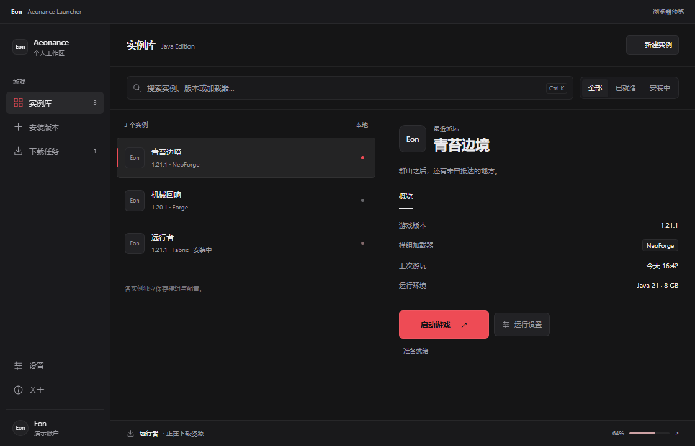

# Aeonance Launcher

An independently developed desktop launcher for Minecraft: Java Edition, with a focus on interface design, smooth interaction, and local instance management.

一款独立开发中的 Minecraft Java 版桌面启动器，注重界面设计、流畅交互与本地实例管理。

**In development · Windows · Source code is not published in this repository**  
**开发中 · Windows · 本仓库不公开程序源码**

## 中文介绍

Aeonance Launcher 希望让游戏版本、实例资料、下载任务和运行环境的管理更加直观。界面支持深浅主题、主次色与全局背景调整，并为页面切换、实例选择和弹窗提供连贯的过渡动效。

### 当前进度

当前内部预览版本为 **0.7.0**，尚未完成可供日常使用的游戏启动流程。

| 功能 | 状态 |
| --- | --- |
| 本地实例资料管理 | 已实现创建、编辑、删除和本地保存 |
| 游戏版本目录 | 已接入版本列表、分类和搜索 |
| 原版游戏下载 | 已实现下载进度、文件校验与修复 |
| Java 管理与启动前检查 | 已实现本机 Java 检测与启动准备检查 |
| Forge、NeoForge、Fabric、OptiFine | 已接入版本查询与选择；加载器安装尚未实现 |
| 微软账号认证 | 已接入设备代码授权与后续认证流程；Minecraft 服务访问资格尚未获准，完整登录尚未验收 |
| 实际游戏启动 | 开发中，尚未实现 |

### 账号认证与隐私

登录在微软网页中完成，启动器不接收微软账号密码。认证流程用于获取玩家的 Minecraft 身份并验证游戏所有权，以支持后续正版游戏启动。实现中，访问令牌仅保存在内存中；完整认证成功后，刷新令牌使用 Windows 当前用户范围的 DPAPI 加密后保存在本机。

目前开发测试已通过微软授权及 Xbox/XSTS 阶段，但 Minecraft 认证接口返回 `Invalid app registration`。项目正在准备申请应用访问资格，尚未完成真实账号的完整认证验证，也不提供绕过游戏所有权检查的功能。

### 后续开发

- 完成应用访问资格申请并验证完整登录流程。
- 接入原版游戏进程启动、日志与启动失败反馈。
- 逐步实现加载器安装与兼容性检查。
- 完善安装包、更新机制及使用文档。

## Interface preview / 界面预览

The image below is an earlier interface prototype with demonstration data. It illustrates the visual direction, not verified game launch or account functionality. The current implementation status is listed above.

下图为使用演示数据的早期界面原型，仅展示视觉方向；图中的账号、游玩记录和进度不代表真实登录或游戏启动结果。实际功能状态以上表为准。

## English overview

Aeonance Launcher is an independent Minecraft: Java Edition desktop launcher in development, currently targeting Windows. Its interface supports light and dark themes, adjustable primary and secondary colors, a global background, and transitions for navigation, instance selection, and dialogs.

### Development status

The current internal preview is **0.7.0**. Local instance metadata management, game version browsing, vanilla game downloads with integrity checks and repair, Java detection, and launch preparation checks are implemented.

Version discovery and selection are available for Forge, NeoForge, Fabric, and OptiFine. **Loader installation and actual game process launch are not implemented yet.**

### Authentication and API access

The application implements Microsoft device authorization followed by Xbox, XSTS, and Minecraft authentication, entitlement verification, and profile retrieval. Access is needed to authenticate players, verify game ownership, and obtain the player profile for future game launch.

Microsoft authorization and Xbox/XSTS authentication have succeeded in development testing. Minecraft Services currently returns `Invalid app registration`; Minecraft API access has not been approved and a complete real-account sign-in has not yet been verified.

Users authorize through Microsoft's website. The launcher does not collect Microsoft account passwords. Access tokens remain in memory; after successful authentication, refresh tokens are stored locally using Windows user-scoped DPAPI encryption. The application is not intended to bypass game ownership checks.

## Repository and contact / 仓库与联系

This public repository contains project information and interface previews. Application source code is not published here. Public availability of these materials does not imply that the application is open source.

本公开仓库用于展示项目介绍和界面预览，不包含程序源码；介绍材料公开不代表启动器已经开源。

- Maintainer / 维护者：[Eon-Floating](https://github.com/Eon-Floating)
- Project / 项目：[Aeonance Launcher](https://github.com/Eon-Floating/Aeonance-Launcher)
- Feedback / 反馈：通过本仓库 Issues 提交一般问题；请勿发布密码、登录验证码或令牌。

Aeonance Launcher is not an official Minecraft product and is not affiliated with or endorsed by Mojang or Microsoft.

Aeonance Launcher 并非 Minecraft 官方产品，与 Mojang 或 Microsoft 无隶属关系，也未获其背书。
